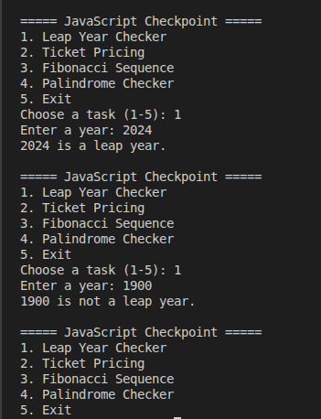
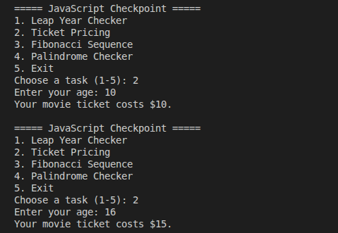
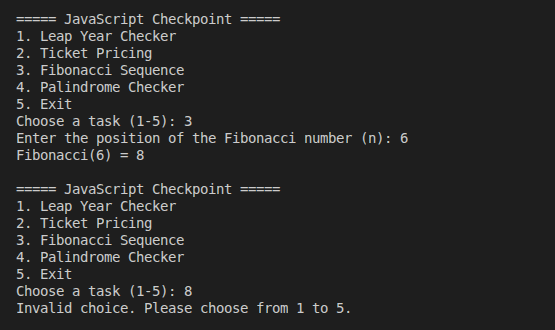
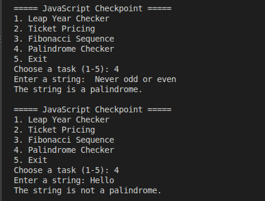

# GMC-Decision-Making-and-Recursive-Algorithms

## Overview

This project demonstrates decision-making statements and recursive functions in JavaScript.

It implements four tasks from the checkpoint:

**Decision Making**

1. Leap Year Checker
2. Ticket Pricing

**Recursion** 3. Fibonacci Sequence 4. Palindrome Checker

The program uses a terminal menu that allows users to choose a task, enter their input, and view the result.

## Task 1: Leap Year Checker

### Description

The Leap Year Checker determines whether a given year is a leap year.

A year is a leap year if:

- It is divisible by 400, or
- It is divisible by 4 but not by 100.

### Screenshot



## Task 2: Ticket Pricing

### Description

The Ticket Pricing task determines the price of a movie ticket based on the user's age.

The pricing rules are:

| Age group               | Ticket price |
| ----------------------- | -----------: |
| Children (12 and under) |          $10 |
| Teenagers (13–17)       |          $15 |
| Adults (18 and over)    |          $20 |

The program uses `if-else` statements to select the appropriate price.

### Screenshot



## Task 3: Fibonacci Sequence

### Description

The Fibonacci Sequence task calculates the Fibonacci number at a given position using recursion.

The sequence starts with:

```text
0, 1, 1, 2, 3, 5, 8, 13, 21, ...
```

Each number after the first two is the sum of the two preceding numbers.

The recursive function uses these base cases:

- `fibonacci(0)` returns `0`.
- `fibonacci(1)` returns `1`.

For other values of `n`, the function calculates:

```javascript
fibonacci(n - 1) + fibonacci(n - 2);
```

### Screenshot



## Task 4: Palindrome Checker

### Description

The Palindrome Checker determines whether a string reads the same forwards and backwards.

The program ignores:

- Capitalization
- Spaces
- Punctuation

For example, `Never odd or even` is a palindrome.

The recursive function compares the characters at the beginning and end of the string.

- If the characters differ, the string is not a palindrome.
- If they match, the function calls itself to compare the next pair of characters.
- When the two positions meet or cross, the string is a palindrome.

### Screenshot



## Concepts Demonstrated

### Decision Making

The Leap Year Checker and Ticket Pricing tasks use `if-else` statements to make decisions based on input values.

The program's menu uses a `switch` statement to determine which task to execute.

### Recursion

The Fibonacci Sequence and Palindrome Checker demonstrate recursion.

A recursive function calls itself to solve a smaller version of the same problem.

Each recursive function needs a base case to stop the recursive calls.

## Complexity Analysis

Let `n` represent the Fibonacci position or the length of the string, depending on the task.

| Task               | Time Complexity | Auxiliary Space Complexity |
| ------------------ | --------------- | -------------------------- |
| Leap Year Checker  | O(1)            | O(1)                       |
| Ticket Pricing     | O(1)            | O(1)                       |
| Fibonacci Sequence | O(2ⁿ)           | O(n)                       |
| Palindrome Checker | O(n)            | O(n)                       |

### Explanation

**Leap Year Checker — O(1)**

The function performs a fixed number of divisibility checks, regardless of the year.

**Ticket Pricing — O(1)**

The function uses a fixed number of conditional statements to determine the ticket price.

**Fibonacci Sequence — O(2ⁿ)**

The straightforward recursive implementation recalculates Fibonacci values multiple times. Its running time grows exponentially as `n` increases.

The maximum recursion depth is proportional to `n`, resulting in O(n) auxiliary space.

**Palindrome Checker — O(n)**

The program first normalizes the string and then recursively compares characters from opposite ends, moving towards the center.

The total time complexity is O(n), and the recursion stack requires O(n) space.

## Conclusion

This project demonstrates the use of conditional statements and recursion to solve common programming problems.

The decision-making tasks use `if-else` and `switch` statements to select outcomes based on user input.

The recursive tasks demonstrate how a problem can be solved by repeatedly calling a function with smaller inputs until a base case is reached.

Together, these examples provide practical experience with fundamental JavaScript programming concepts.
